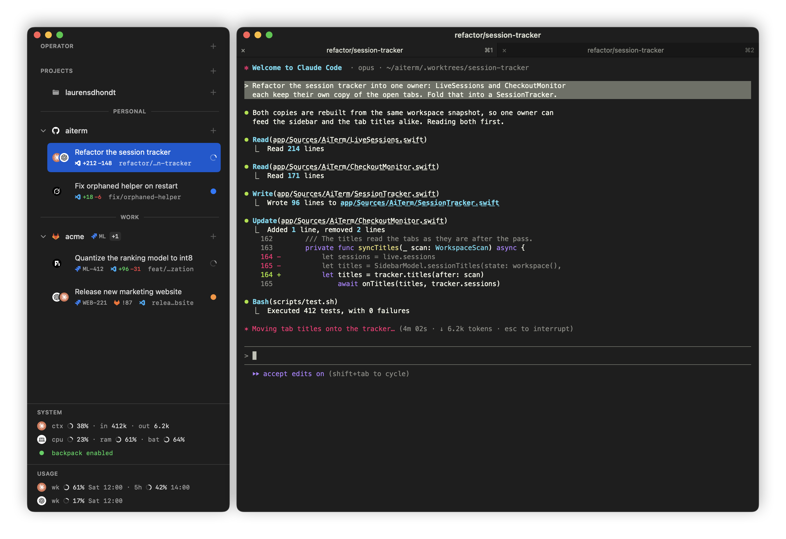

# AiTerm

A native macOS sidebar that runs coding agents in real iTerm2 windows, one git worktree per task,
with an Operator that plans the work and steers the agents for you.

> AiTerm is built for its maintainer's own workflow. Bug reports are welcome; feature requests and
> pull requests are not taken. See [CONTRIBUTING.md](CONTRIBUTING.md).

## At a glance

The sidebar sits beside iTerm2 and keeps every task's window tiled next to it. AiTerm drives the
real iTerm2 through its Python API; it does not embed a terminal.

- **Operator group**: the broadcast at the top, with the Operator's own row and the tasks it drives,
  each saying what the Operator is doing (`Operator watching`, `waiting on you`).
- **Projects**: GitLab, GitHub, plain git or a plain folder, grouped under dividers you name.
- **Task rows**: the agents in the task's tabs, a status mark (working, needs input, done), and
  badges for the Jira ticket, the merge request and the lines changed.
- **Reviews**: a merge or pull request checked out in its own worktree, its resolved review
  threads counted on the row.
- **Footer**: the selected task's context fill, the Mac's CPU, memory and battery, and each
  agent's account usage.
- **The Shelf** (⌘S): tasks put away, ready to restore, and ended broadcasts to read back.
- **Focus View** (⌘F): opens only the projects with a row waiting on you, which the Dock badge
  counts. **List View** (⌘L) opens them all again.
- **Windows that come back**: after a crash, a reboot or iTerm2 quitting, every task's window
  reopens with its conversations.

**Backpack Mode** (⌘B) keeps the Mac awake with the lid shut while agents work, joined to your
iPhone's hotspot. It turns itself off two minutes after the last agent stops, or when the battery
reaches 10 %. The footer's `backpack enabled` line shows it is on.

## Install

Needs macOS 26 or newer, iTerm2 with its Python API on (*iTerm2 › Settings › General › Magic ›
Enable Python API*), and `python3` 3.11 or newer (`brew install python`).

1. Download the DMG from the [latest release](https://github.com/dhondtlaurens/aiterm/releases/latest)
   and drag **AiTerm** to Applications.
2. Open it. The release is self-signed, so allow the first launch once in *System Settings ›
   Privacy & Security › Open Anyway*. If you copied the app some other way, clear the download flag
   first (`xattr -dr com.apple.quarantine /Applications/AiTerm.app`): a quarantined app runs from a
   temporary copy and skips the Claude status line.
3. Allow AiTerm's API connection when iTerm2 asks. The sidebar says "Waiting for iTerm2…" until you
   do; if you declined, turn the Python API on again in iTerm2 and relaunch AiTerm.
4. In *Settings › Agents*, press **Install** on each agent you use.

*AiTerm › Check for Updates…* installs newer versions in place.

### Install it with your AI

Paste this into Claude Code, Codex or another coding agent:

    Install AiTerm on this Mac for me by following
    https://raw.githubusercontent.com/dhondtlaurens/aiterm/main/docs/ai-install.md

The agent checks the requirements, downloads the latest release, verifies its checksum, copies the
app to Applications and switches on iTerm2's Python API. It asks before installing anything
missing, and stops for the clicks only you can make. The steps are in
[docs/ai-install.md](docs/ai-install.md).

### What AiTerm changes on your machine

- **Agent drivers**: only when you press **Install** on an agent's card; a backup is kept next to
  every file it edits.
- **A local port**: the helper listens on `127.0.0.1:47821` for the agents' hooks.
- **Backpack Mode**: only after **Allow…** on the Mac card, the sudoers rule `/etc/sudoers.d/aiterm`
  that lets AiTerm switch lid sleep with `pmset`. **Remove** takes it out.
- **Worktrees**: one per task, under `<repo>/.worktrees/`.
- **Its own state and log**: `~/Library/Application Support/AiTerm/`.

The full list is in [docs/architecture.md](docs/architecture.md#what-aiterm-writes-and-where).

### Build from source

Needs Swift 6.4 through [Swiftly](https://www.swift.org/install/macos/) (`swiftly install --use 6.4`).

    scripts/run-dev.sh    # build build/AiTerm.app and open it in place of the installed one
    scripts/test.sh       # the suites this branch's changes can affect
    scripts/test.sh all   # every suite

A local build wears a DEV pill on its Dock icon and does not update itself. More in
[scripts/README.md](scripts/README.md), [docs/architecture.md](docs/architecture.md) and
[docs/status-model.md](docs/status-model.md).

## Concepts

You add projects, start a task for each piece of work, and the agent works in its own worktree and
iTerm2 window while the sidebar shows where each one stands. Hand a batch of work to the Operator
as a broadcast and it starts and steers the tasks for you.

- **Project**: a repository or folder in the sidebar. A Jira project can be linked to it.
- **Task**: one piece of work: its own git worktree and branch, its own iTerm2 window, started from
  a Jira ticket or a prompt (⌘N). The gitignored files `.worktreeinclude` names are copied in.
- **Tab**: an agent in a task's window. A task can hold several, each its own agent.
- **Terminal**: a plain shell in the project folder, with no worktree (⌘T).
- **Review**: a merge or pull request checked out in its own worktree, with an agent on it (⌘R).
- **The Shelf**: puts a task away. Its worktree goes and its branch stays; restoring brings back
  the worktree and its conversations.
- **Broadcast**: one prompt to the Operator across one or more projects. It plans the tasks, starts
  them and steers them to the end you set. One runs at a time.

## Settings

Four panes, ⌘1 to ⌘4. Everything waits for **Save**, except an agent's install and Help with
problems, which apply at once, and the sidebar size, which shows at once and Cancel puts back.

### Agents

The coding agents AiTerm launches and reads. Each card tests its agent when Settings opens and
shows three checks; one button installs or repairs what is missing. Claude Code and Codex are fully
supported; other providers, such as Grok, run through PI.

- **Help with problems**: when a git step fails (a diverged branch, a conflicted rebase), New
  Review's footer and Pull main's banner offer **Find a Fix**. Claude Code reads the problem in a
  clone and proposes a fix; nothing changes until you press **Apply**. Needs Claude Code; on by
  default.

Every agent card has the same parts:

- **CLI**: the agent's command is on your login shell's `PATH`.
- **Driver**: what reports the agent's status to AiTerm.
- **Messaging**: whether AiTerm can type into the agent's session safely on the installed version,
  proven by a delivery check. The Operator steers its workers this way.
- **Install / Repair / Reinstall**: installs a missing CLI with its vendor's installer, then
  AiTerm's driver. **Run check** appears when only Messaging is missing: it opens iTerm2 and runs
  the delivery check, which takes a few minutes.
- **Default model** and **Default reasoning**: what a new task starts on, and what the Operator
  gives an agent when it names no model.

#### Claude Code

Anthropic's agent, and the one the Operator itself runs on.

- **CLI**: `claude`.
- **Driver**: HTTP hooks and a status-line bridge for usage, merged into `settings.json` under
  `$CLAUDE_CONFIG_DIR` (default `~/.claude`). The card shows that path.
- **Messaging**: checked per Claude Code version.
- **In the app**: task rows and tabs, context and account usage in the footer, the Operator, a
  worker, the Oracle, an agent reviewer and Find a Fix.

#### Codex

OpenAI's agent.

- **CLI**: `codex`.
- **Driver**: command hooks and an MCP server for `Stop`, merged into `~/.codex/config.toml`.
- **Messaging**: checked per Codex version.
- **In the app**: task rows and tabs, context and account usage in the footer, a worker, the
  Oracle (its default) and an agent reviewer.

> **Codex runs without approvals.** Codex tasks launch with
> `--dangerously-bypass-approvals-and-sandbox`, which turns off Codex's approval prompts and
> sandbox. The New Task command preview shows the flag before anything runs.

#### PI

An open agent harness that reaches many model providers; its models come from the providers you
signed in to with `/login` in PI.

- **CLI**: `pi`.
- **Driver**: an extension AiTerm owns in `~/.pi/agent/extensions/`.
- **Messaging**: not built for PI, so the Operator cannot start or steer a PI task.
- **In the app**: task rows and tabs you start yourself, with context fill (no account usage), the
  Oracle, and an agent reviewer.

### Operator

The Operator is Claude Code in its own iTerm2 window, given one broadcast at a time. It plans the
tasks, starts their agents, answers them from the brief and the code, and accepts or sends back
their work. It reads code but never writes it; its agents do. Start one with the **+** on the
OPERATOR heading; a click on the broadcast opens its board (**Board**, **Activity**, **Summary**).

- **Agent**: Claude Code, with its **Model** and **Reasoning**. Its workers are Claude Code or
  Codex, on their default model from Settings › Agents unless it picks another from that list. New
  tasks move to the other agent once one's weekly use reaches 80 %.
- **Base** (always on): plans, starts tasks, steers and answers its agents, adds backlog tasks,
  commits, pushes the task's branch, opens a draft MR and runs agent reviews.
- **Jira** slice: creates and updates tickets in the broadcast's Jira projects.
- **Review** slice: marks the MR ready, assigns reviewers, has the agent fix their feedback and
  replies in the threads.
- **Merge** slice: merges, through the MR or locally without pushing, when your Done condition
  holds. Only a commit it accepted, with the pipeline green and every thread resolved.
- **Never**: writes code, deploys, force-pushes, pushes to a default or protected branch, or answers
  an agent's permission prompt.
- **Oracle**: a second agent (Claude Code, Codex or PI, with its model and reasoning). It critiques
  the plan and the Operator's verdicts, and has the last word on backlog additions past a quarter
  of the first plan, on merges and on shell commands the gate does not clear. PI checks with
  read-only tools, not a sandbox. On by default with Codex, when Codex is installed.
- **Instructions**: house rules for every broadcast; `/` lists the agents' skills.

The slices are off by default, and a broadcast keeps the settings it started with. A slice is
enforced by AiTerm, which does every Jira and code-host write itself and refuses one whose slice is
off; what that left undone shows under *Left for you* in the Summary.

**The gated shell.** The Operator has a shell, but every command passes a gate first. A plain read
inside the broadcast's checkouts runs at once; push, commit, reset, checkout, clean, merges and
writing `gh`/`glab api` calls are refused outright; everything else goes to the Oracle, which runs
it, sends the Operator to a worker, or asks you. When the Oracle cannot answer, the command runs
and is logged.

**PI and the Operator.** PI can be the Oracle, and `review_task` can run a PI agent review. Workers
and extra tabs are Claude Code or Codex only, since AiTerm cannot message PI yet.

**Its tools.** The Operator acts only through AiTerm's MCP tools:

| For | Tool | What it does |
|---|---|---|
| Status | `run_status` | The broadcast now: every task's state, branch, last commit and what is open. |
| Jira | `jira_search`, `jira_board` | Read tickets and boards of the broadcast's Jira projects. |
| | `jira_create`, `jira_edit`, `jira_comment` | Create, edit and comment on tickets (Jira slice). |
| | `jira_move`, `jira_link`, `jira_sprint` | Move status, link tickets, put them in a sprint (Jira slice). |
| Plan | `create_task`, `update_task` | Add an unstarted task, or change its brief, agent, model or end. |
| | `submit_plan` | Close a plan revision; its tasks are queued at once. |
| Steer | `message_task` | Type a message into a started task's worker. |
| | `open_tab` | Add another worker tab to a task, on the same worktree. |
| | `read_task` | Read a worker's last message, diff, open prompt or review. |
| | `resume_task`, `retry_task` | Put a blocked task back to work; queue a failed one again. |
| Review | `review_task` | Start an agent review of a task's branch (Claude, Codex or PI). |
| | `find_user` | Find people on the code host who may review. |
| | `request_review`, `reply_thread` | Mark the MR ready and ask reviewers; reply in a thread (Review slice). |
| Finish | `mark_task` | Record a task's outcome: accepted, no change, blocked or failed. |
| | `finish_task` | Carry out an accepted task's end: a commit, a draft MR, or a merge (Merge slice). |
| You | `ask_you`, `resolve_question` | List a question under *Waiting on you*; close it once answered. |
| Record | `report_find`, `report_snag` | Note an off-brief find (filed in Jira with the slice on); note an AiTerm glitch. |
| | `leave_for_you`, `log_decision` | Note what a slice kept it from; log a decision it took. |
| | `write_summary` | Write the broadcast's summary once it is complete. |

### Integrations

The connections AiTerm needs (Core) and the services it reads and writes (Services). Each card
tests itself as you type; tokens are kept in the Keychain, and **Disconnect** removes them.

- **iTerm2**: the Python helper's connection, with numbered steps when it is not working.
- **Mac**: Backpack Mode's two permissions, **Lid sleep** (the sudoers rule, one password prompt)
  and **Network discovery** (Location access, which macOS needs to show Wi-Fi names; AiTerm never
  reads where you are). **Allow…** grants them, **Remove** takes the rule out.
- **Jira** (site URL, email, API token): New Task picks a ticket, names the task and branch after
  it, and with *Include Jira ticket details* puts the ticket in the agent's first prompt. Jira keys
  show on rows and project headers, a broadcast's prompt brings in the tickets it names, and the
  Operator reads and, with its slice on, writes Jira.
- **GitLab** (host URL, access token): reviews of merge requests, their resolved threads on the
  row, and the Operator's MRs. Reading needs `read_api`; opening or merging needs `api`.
- **GitHub** (access token, github.com only): the same for pull requests. Reading needs read access
  to pull requests; opening or merging needs write access to pull requests and contents, and read
  access to administration for branch protection.

### Interface

How the sidebar and AiTerm's terminal windows look.

- **Use dark terminal background**: paints AiTerm's terminal windows `#1E1E1E`; your iTerm2
  profiles stay unchanged.
- **Sidebar size**: Actual Size, Large or Extra Large; also ⌘+, ⌘− and ⌘0.
- **Sidebar badges**: show or hide the Jira project count, Jira ticket key, merge request number
  and lines changed. A hidden badge leaves its mark.
- **Keyboard shortcuts**: every shortcut, read-only. The full list is in
  [docs/keyboard.md](docs/keyboard.md).

## Screenshots worth adding

The README uses `docs/desktop.png` (above). The snapshot suite
(`scripts/snapshots.sh`) already draws most of these, so each could be added from there:

- **The board while a broadcast runs** (`board-running.png`): the four columns, a request waiting
  on you, the Operator answering an agent.
- **A broadcast's Summary** (`board-summary.png`): the Operator's prose summary and what was left
  for you.
- **New Broadcast** (`new-broadcast-1.png`): name, Jira projects and projects, before the prompt.
- **Settings › Agents** (`settings-agents.png`): the three cards with their CLI, Driver and
  Messaging checks.
- **Settings › Operator** (`settings-operator.png`): the slices, the never lines and the Oracle.
- **Find a Fix** (`banner-find-a-fix-proposal.png`): a proposed fix with Apply.
- **Backpack Mode** (`backpack-sheet-*.png`): the sheet that joins the hotspot.
- **The Shelf** (`archive.png`): shelved tasks and an ended broadcast.

## Licence

Copyright © 2026 Laurens D'Hondt. AiTerm is free software under the
[GNU General Public License v3.0](LICENSE).

The app bundles the [`iterm2`](https://pypi.org/project/iterm2/) Python package (GPLv2 or later),
[`websockets`](https://pypi.org/project/websockets/) and
[`protobuf`](https://pypi.org/project/protobuf/) (both BSD-3-Clause). Claude, Codex, PI, Jira,
GitLab and GitHub names and logos belong to their owners and are used only to identify those tools.
