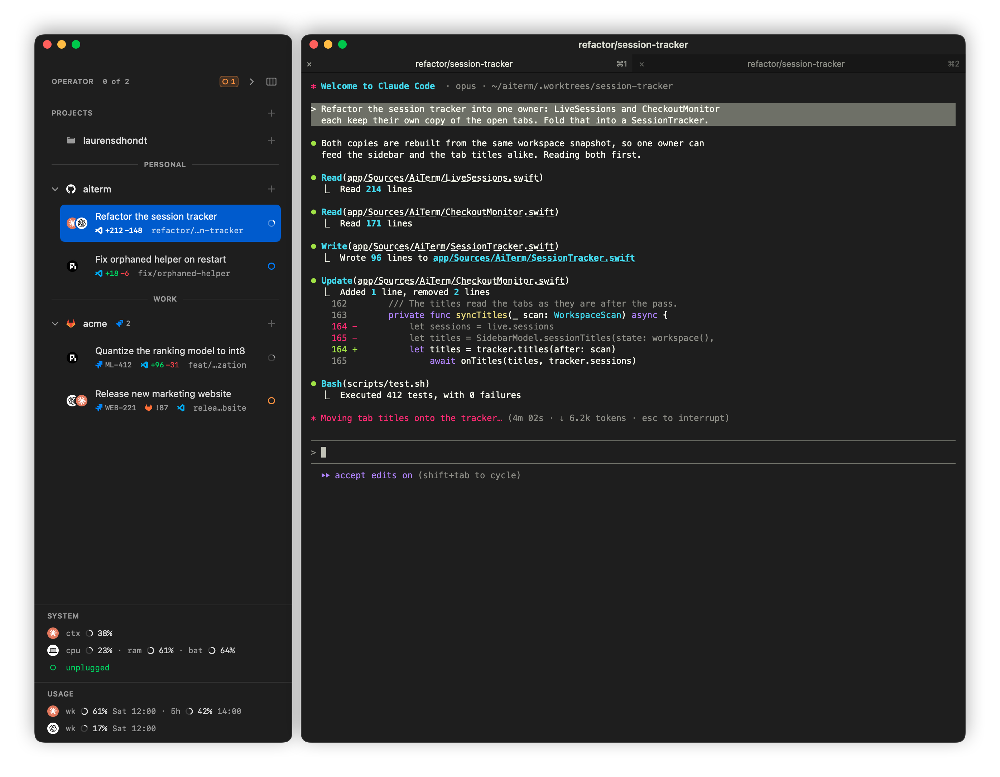

# AiTerm

Keep your coding agents organised across projects. AiTerm is a native macOS sidebar for
**Claude Code and Codex** in real iTerm2 windows. Run tasks in separate Git worktrees, see which
agents need your attention, and coordinate changes across repositories.

[Download the latest release](https://github.com/dhondtlaurens/aiterm/releases/latest)
· [Install](#install) · [Try your first task](#try-your-first-task) · [Configuration](docs/configuration.md)



*Projects and tasks stay in the sidebar; the selected task opens in its own iTerm2 window.*

## What you can do

### Give each task its own workspace

Work on a fix and a feature at the same time, each on its own branch and checkout. AiTerm creates
the task's Git worktree under `<repo>/.worktrees/` and opens its agent in iTerm2.

### Use several agents on one task

In a task's iTerm2 window, press ⌘T and start another agent, such as `claude` or `codex`.
Tabs share the task's worktree, so they work with the same files. Quitting AiTerm leaves your
iTerm2 windows and agents running.

### See what needs your attention

Status marks show working agents, requests for input, background work and unread completed turns.
**Focus View** (⌘F) opens projects with rows waiting on you; **List View** (⌘L) opens them all.
The footer shows the selected tab's context, Mac readings and supported agents' account usage.

### Coordinate work across projects

Give the **Operator** one brief across selected projects. This is a **broadcast**: the Operator
plans tasks, starts workers, reviews their results and carries accepted work to the end you choose,
such as a commit, draft request or merge. You choose the permitted agents and capabilities.
One broadcast runs at a time. See [the Operator guide](docs/operators.md).

### Bring reviews into your workspace

Open a branch or merge/pull request with **New Review…** (⌘R). It gets a review worktree, or opens
in the existing task when that branch is already checked out there. Review badges count resolved
threads. The Operator can also start read-only review tabs as part of its workflow.

### Put work aside and pick it up later

**Shelve** a task to keep its branch and conversations while removing its worktree. Open the
**Shelf** (⌘S) to restore it later. Ended broadcasts stay there to read. See
[rows and windows](docs/windows.md) for closing, restoration and reconnect behaviour.

## Install

Requires **macOS 26+**, **iTerm2** and **Python 3.11+**. Enable
**iTerm2 › Settings › General › Magic › Enable Python API**.

1. Download the DMG from the [latest release](https://github.com/dhondtlaurens/aiterm/releases/latest)
   and drag AiTerm to Applications.
2. Open it. The release is self-signed; allow its first launch in **System Settings › Privacy &
   Security › Open Anyway** when macOS asks. If necessary, clear the download flag with
   `xattr -dr com.apple.quarantine /Applications/AiTerm.app`.
3. Allow AiTerm's API connection when iTerm2 asks. Until then the sidebar shows “Waiting for iTerm2…”.
4. Open **Settings › Agents** and press **Install** for each agent you use. This installs a missing
   CLI and AiTerm's driver. Sign in through the chosen agent's CLI as needed; you use your own agent
   account or API access.

**Codex tasks run with `--dangerously-bypass-approvals-and-sandbox`.** The task sheet previews the
command before launch. Ordinary **New Review…** uses the normal agent command; the Operator's
review tabs use separate read-only restrictions. [Agent configuration](docs/configuration.md#agents).

Use **AiTerm › Check for Updates…** for subsequent versions. To have a coding agent install it,
give it [the installation guide](docs/ai-install.md):

    Install AiTerm on this Mac by following
    https://raw.githubusercontent.com/dhondtlaurens/aiterm/main/docs/ai-install.md

## Try your first task

Start with an existing Git repository that has a committed base branch, and an installed agent.
Jira, GitHub and GitLab service connections are optional for this task.

1. Choose **File › Add Project…** (⌘P) and select your repository folder.
2. Select its project in the sidebar, then choose **File › New Task…** (⌘N).
3. In **Task**, enter a name, such as “Explain the test setup”. Check the new branch name and choose
   a base branch that exists. Continue without a Jira ticket.
4. In **Agent**, choose an installed agent, an available model and its reasoning level, then continue.
5. In **Prompt**, describe the work. For example: “Find the test commands for this project and
   explain how to run them.” Check the command preview and press **Create Task**.

Your task appears in the sidebar with its own branch, worktree and iTerm2 agent window. Select it
to return to that window, and answer any agent sign-in or folder-trust prompt there.
For one brief across several projects, try [a broadcast](docs/operators.md#set-up-a-broadcast) (⌘B).

## More ways to work

- **Organise your projects:** add GitHub, GitLab or local repositories and plain folders. Group
  them under named dividers and optionally link Jira projects.
- **Open a shell:** **New Terminal…** (⌘T) starts in the project folder without creating a worktree.
- **Bring local files along:** `.worktreeinclude` selects ignored files, such as `.env`, to copy
  into new task worktrees. [Worktree files](docs/configuration.md#files-in-task-worktrees).
- **Use other providers:** PI supports manually started tasks and tabs, context reporting and the
  Oracle; providers such as Grok run through PI. [Agents](docs/configuration.md#agents).
- **Recover from Git problems:** **Find a Fix** asks Claude to inspect an isolated clone and propose
  a fix for you to apply. [Help with problems](docs/configuration.md#help-with-problems).
- **Keep work running with the lid closed:** **Unplugged** (⌘U) joins your phone's hotspot and needs
  Lid sleep permission and Location access for network discovery. It stops at 10% battery and can
  stop after your agents finish. [Unplugged setup](docs/configuration.md#mac-and-unplugged).

See [configuration](docs/configuration.md) for settings, integration permissions and agent checks;
the [keyboard reference](docs/keyboard.md), [window guide](docs/windows.md) and
[status guide](docs/status-model.md) cover everyday controls and behaviour.

## Local data

AiTerm keeps workspace state and logs under `~/Library/Application Support/AiTerm/`, task worktrees
under each repository, and service tokens in the Keychain. Installing agent drivers writes their
integration files with backups. Agent requests use your chosen provider's services and configuration.
See [data ownership](docs/architecture.md#what-aiterm-writes-and-where) for exact files, local
transports and the optional lid-sleep rule.

## Help and project scope

Found a problem? [Report a bug](https://github.com/dhondtlaurens/aiterm/issues/new?template=bug_report.yml).
For a security issue, use [private vulnerability reporting](https://github.com/dhondtlaurens/aiterm/security/advisories/new).

AiTerm is built for its maintainer's workflow. Bug reports are welcome; feature requests and pull
requests are not taken. [CONTRIBUTING.md](CONTRIBUTING.md) explains what to include in a report
and how to change the app yourself.

## Develop

Use a Git worktree and Swift 6.4 through [Swiftly](https://www.swift.org/install/macos/).

```sh
scripts/make-app.sh       # build and sign build/AiTerm.app, without launching
scripts/test.sh          # checks selected from this branch's changes
scripts/test.sh all      # complete automated gate before merging
scripts/run-dev.sh       # replace the running AiTerm with the development build
```

`run-dev.sh` quits the running app and replaces its helper. Development and installed builds share
state and connections; schedule that switch when existing work permits it. A DEV build does not
self-update. Never run a second live copy alongside the installed app.

Read [architecture](docs/architecture.md), [testing](docs/testing.md),
[script reference](scripts/README.md), [UI rules](app/Sources/AiTermUI/README.md) and
[release procedure](docs/workflow/release.md). [AGENTS.md](AGENTS.md) contains the repository's working rules.

## Licence

Copyright © 2026 Laurens D'Hondt. Licensed under [GNU GPL v3.0](LICENSE).
The app bundles `iterm2` (GPLv2 or later), `websockets` and `protobuf` (BSD-3-Clause).
Vendor names and logos identify their respective tools and belong to their owners.
